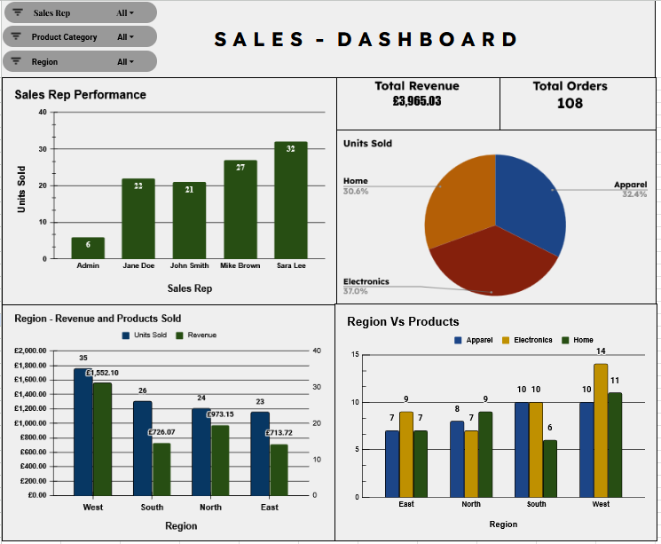

# Sales Dashboard — Google Sheets

A spreadsheet dashboard project built from a deliberately messy synthetic sales dataset. The work focuses on preparing inconsistent data, documenting missing-value decisions and presenting sales measures through an interactive dashboard.

> **Data note:** The source records are synthetic and are used for practice. They are not real company sales data. The repository includes an `.xlsx` workbook export.

## Preview

[Open the workbook export](Sales-Dashboard-Google-Sheet.xlsx)

## Data preparation

The dataset was prepared before analysis:

- Trimmed whitespace and standardised inconsistent text casing in category fields.
- Standardised inconsistent date formats.
- Removed exact duplicate rows.
- Removed inconsistent currency symbols from price values.
- Checked column data types, including numeric price fields and text fields.

## Missing-value decisions

| Field condition | Treatment |
|---|---|
| Missing units sold or unit price | Filled using the average for the relevant product category |
| Both units sold and unit price missing | Removed the row because there was insufficient information for a meaningful estimate |
| Missing sales representative | Used the explicit placeholder `Admin` |

These are analytical choices, not neutral operations. Category-average imputation can reduce variation and may distort totals or comparisons. The `Admin` placeholder represents an unknown or missing representative; it should not be interpreted as a genuine salesperson.

## Dashboard

- **Filters:** sales representative, product category and region.
- **KPIs:** total revenue and total orders.
- **Charts:** units sold by sales representative, category share, regional revenue and product volume, and region-by-category comparisons.

The regional revenue and product-volume comparison uses separate axes because the measures have different scales. They should be read as two measures, not as directly comparable values.

## Skills demonstrated

- Spreadsheet data cleaning and standardisation.
- Duplicate handling and data-type validation.
- Documenting missing-data treatment and its limitations.
- KPI design, charts and interactive slicers.
- Communicating how data-preparation decisions can affect analysis.

## Limitations and possible next steps

The dataset is synthetic, and the imputation choices are intended to demonstrate a documented workflow rather than establish a universally correct method. Further work could compare category-average imputation with median imputation, retain a flag for imputed records, and test how the choices affect reported revenue.

## Companion project

The [Excel Sales Dashboard](https://github.com/Mishayam/sales-dashboard-excel) demonstrates a related dashboard workflow using Excel formulas, lookup functions and slicers.

## Files

- [Workbook export](Sales-Dashboard-Google-Sheet.xlsx)
- [Dashboard screenshot](screenshot.png)
